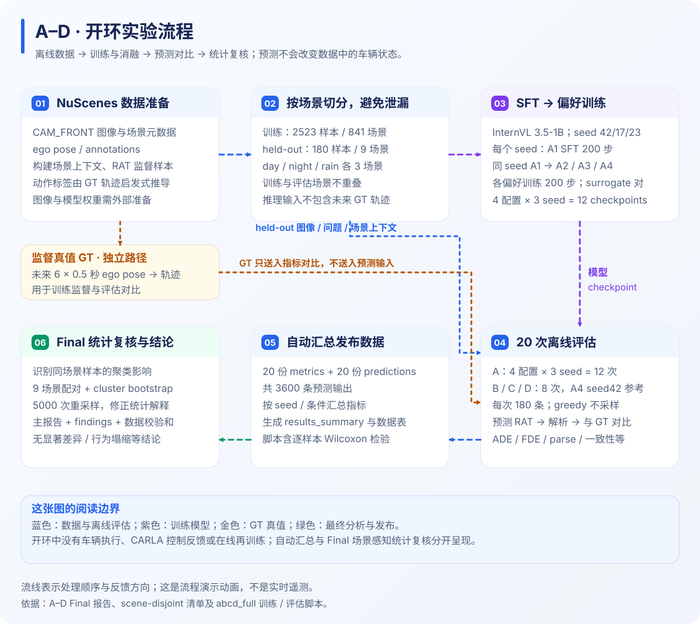
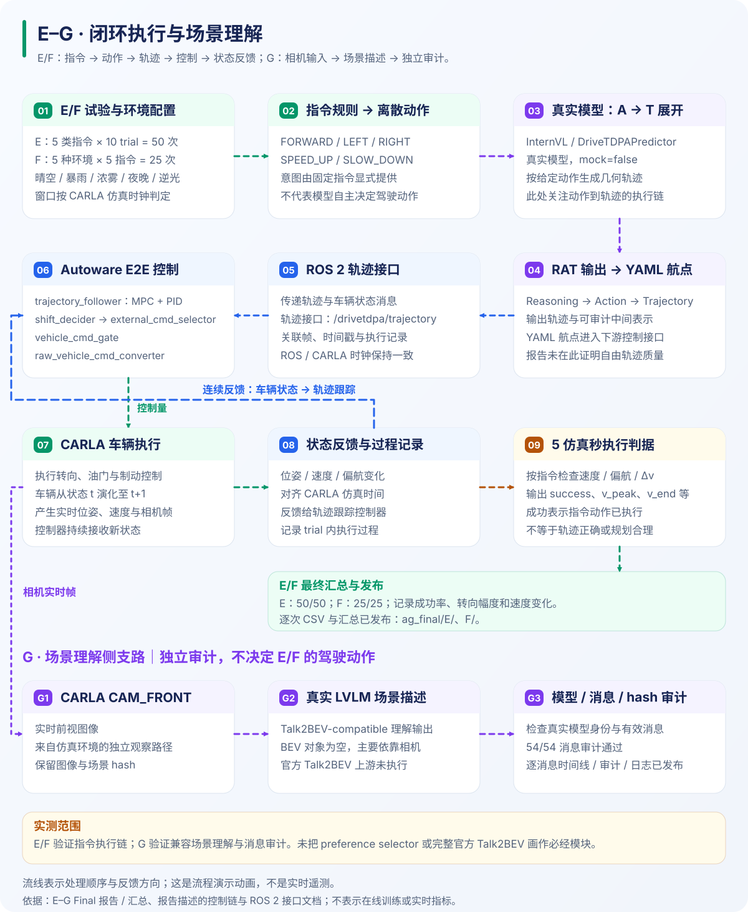
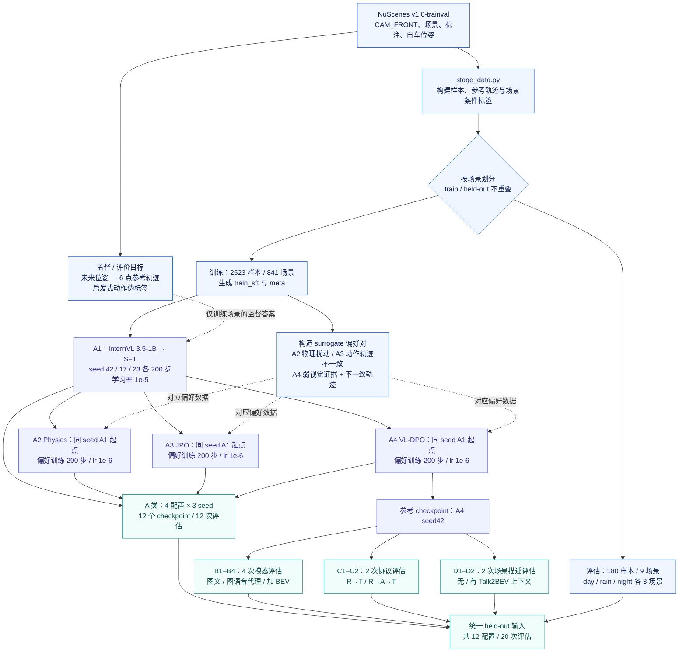
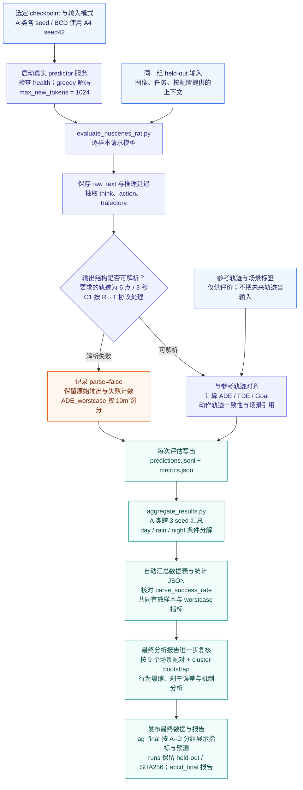
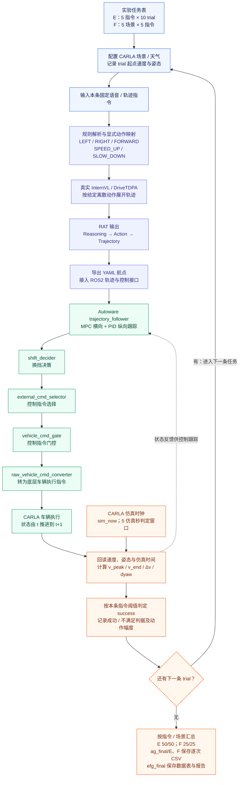
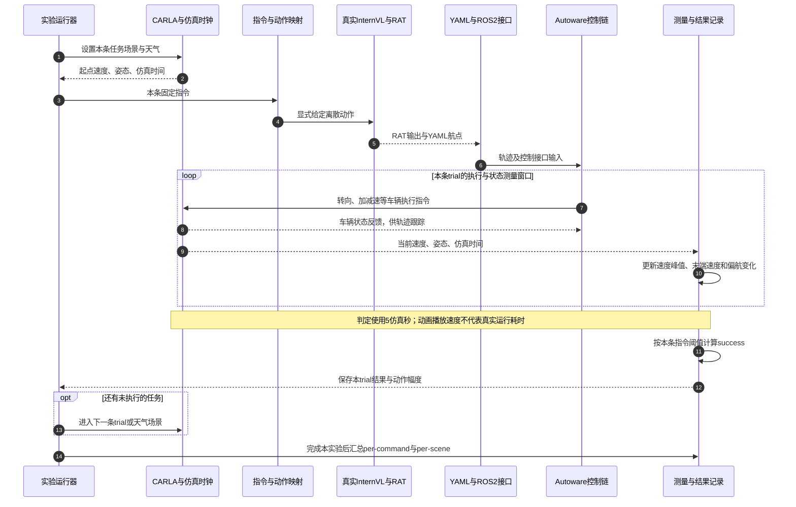
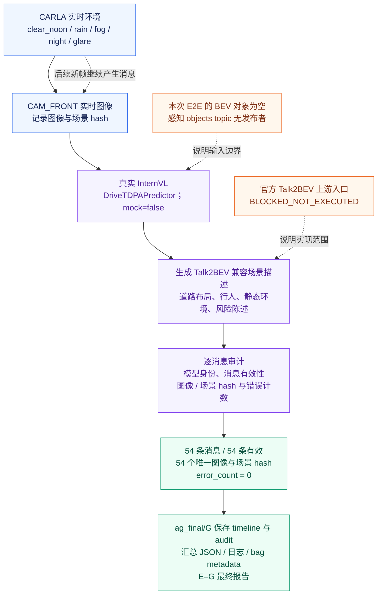

# 开环与闭环 · 详细动态流程图

[返回项目首页](../README.md) · [A–G FINAL](../FINAL_RESULTS.md) · [中文文档导航](README.md) · [播放动态流程图](experiment_flows.html)

**先看流动路径，再展开模块细节。** 蓝色表示 A–D 开环实验，绿色表示 E/F 执行闭环，紫色表示 G 场景理解与审计。动画用于解释数据流与控制流，不代表实时连接实验服务器。

[开环训练](#open-training) · [开环评估](#open-evaluation) · [闭环执行](#closed-execution) · [闭环时序](#closed-sequence) · [G 场景理解](#scene-audit) · [输入输出与证据](#evidence)

> **动态查看方式**：首页和本页的 SVG 预览展示流动箭头；浏览器支持或减少动态效果设置会影响动画显示。点击[播放动态流程图](experiment_flows.html)可进入交互版；GitHub 文件页展示 HTML 源码时，下载该 HTML 后用浏览器打开。下方 Mermaid 图提供可维护、可直接在 GitHub 阅读的详细版本。

## 先分清两条实验路线

| 对比 | A–D：NuScenes 开环 | E/F：CARLA 执行闭环 | G：实时场景理解与审计 |
| --- | --- | --- | --- |
| 输入来源 | 已录制图像、任务、场景上下文和参考轨迹 | 五类固定指令、仿真场景及车辆状态 | CARLA 实时前视相机 |
| 意图 / 动作来源 | 模型基于输入生成，受 B/C/D 配置改变 | 指令被规则显式映射为离散动作，模型展开轨迹 | 场景描述与审计，不按车辆动作成功率计分 |
| 预测后发生什么 | 对齐同一评估样本的参考轨迹，计算指标 | 轨迹接入控制链，实际改变 CARLA 车辆状态 | 生成消息，检查真实模型身份、有效性和 hash |
| 反馈方向 | 评估结果进入统计与报告；不驱动车辆 | 下一时刻状态回到控制跟踪与执行判定 | 新相机帧产生后续消息；不据此认定每帧自主重规划 |
| 最终问题 | 轨迹准不准？组件与输出协议有何作用？ | 车辆是否按给定指令执行？幅度是否可重复？ | 真实模型是否产生可审计的场景理解消息？ |

## 动态预览

### 开环：数据 → 训练 → 推理 → 对照评估 → 统计报告

### 闭环：指令 → 轨迹 → 控制 → 车辆 → 状态反馈

## 01 · 开环 A–D：数据准备、训练与消融配置

A–D 使用 `drivetdpa_abcd_nuscenes_20260930` 对应的全量结果。**按组浏览优先进入 [ag_final/A–D](../experiments/ag_final/README.md)**，该分组数据目录于 **2026-10-26** 发布；原 [runs 发布包](../experiments/runs/drivetdpa_abcd_nuscenes_20260930/)继续提供 held-out 切分与 SHA256。先按场景切分，再训练 A 类；B/C/D 在同一参考 checkpoint 上改变输入或输出协议。训练和评估在外部 DriveTDPA 主项目执行，本仓库保存脚本副本、结果和报告。

**为什么是 20 次评估而不是 12 次？** A 类四个配置各评估三个训练 seed，共 12 次；B/C/D 各为单 checkpoint 的协议 / 输入消融，共 4+2+2=8 次。因此发布包有 **20 份 metrics 和 20 份 predictions**。

未来参考轨迹和启发式动作伪标签用于监督答案与离线评价，不能混入 held-out 的模型推理输入。训练中的 surrogate 偏好对由脚本构造，不是 CARLA 同帧多采样加真实 judge 的偏好包。B 类语音是文本转写 proxy，也没有在此处接入真实 ASR 编码器。

## 02 · 开环 A–D：逐样本推理、失败计入与最终统计

开环的每条预测都与已录制参考轨迹比较，不把预测送进 CARLA 改变下一帧。模型解析失败也属于结果，不能只统计成功样本而隐藏输出可用性。`ADE_common` 用于共同有效样本的可比评价；`ADE_worstcase` 同时反映误差和解析失败。

**自动汇总与最终解释分开**：pipeline 的汇总表包含逐样本检验；最终主报告进一步考虑同一场景样本的聚类，使用场景感知检验。流程图因此把“自动汇总”与“最终复核”画成两个阶段，避免误认为所有最终统计都由现有聚合脚本自动生成。

## 03 · 闭环 E/F：指令、轨迹、控制与车辆反馈

E 为 **5 类指令 × 10 trial = 50 次**；F 为 **5 场景 × 5 指令 = 25 次**。五类指令为 `FORWARD`、`LEFT`、`RIGHT`、`SPEED_UP`、`SLOW_DOWN`；F 的场景为晴空正午、暴雨、浓雾、夜晚和日落逆光。

图中的反馈连接表示车辆状态用于控制跟踪与 trial 判定。现有报告没有据此证明“每个传感器帧都重新调用模型自主规划”，因此没有画成模型逐帧重新决策的循环。进入下一条 trial 也不等于自动重试失败任务；当前发布结果 E/F 全部通过。

**起点状态需要保留**：F 的晴空基线出现跨 trial 状态残留。图中只写“记录起点状态”，没有把“每次强制完全复位”当作已经做到的步骤；强制静止复位属于报告提出的后续改进。

### 五类指令如何判定

| 指令 | 执行动作 | 报告中的成功判据 | 记录量 |
| --- | --- | --- | --- |
| `FORWARD` | 前进且基本保持方向 | `min_v ≥ 0.3 m/s` 且 `abs(dyaw) ≤ 0.2 rad` | 速度、偏航角变化 |
| `LEFT` | 左转 | `dyaw ≥ 0.1 rad` | 累计偏航角变化 |
| `RIGHT` | 右转 | `dyaw ≤ -0.1 rad` | 累计偏航角变化 |
| `SPEED_UP` | 加速 | `Δv ≥ 0.25 m/s`，增量取峰值减起点速度 | `v_peak`、`base_v` |
| `SLOW_DOWN` | 减速 | `Δv ≤ -0.25 m/s`，增量取末端减起点速度 | `v_end`、`base_v` |

表内阈值偏航角使用 **rad**；报告中的动作幅度展示常换算成 **°**。判据衡量指令执行，不判定该动作是否符合当前道路任务或避障需要。

## 04 · 单次闭环 trial：按时间发生什么

时序图按报告中的模块职责绘制，不给出未发布源码中的线程调度、控制频率或 ROS 消息发送次数。控制循环、5 秒判定窗口、模型调用耗时属于不同时间尺度。

## 05 · G：CARLA 实时相机 → 场景理解 → 审计

G 与 E/F 使用同一 CARLA 实时环境，但评价对象是场景理解消息。图中不把 G 的审计消息画成 E/F 动作的必经决策条件。

**已入库数据**：[G 的 54 条时间线](../experiments/ag_final/G/audit/lvlm_scene_context_timeline.jsonl)、[审计 JSON](../experiments/ag_final/G/audit/lvlm_scene_context_audit.json)、[汇总与运行日志](../experiments/ag_final/G/)于 2026-10-26 发布。[bag 元信息](../experiments/ag_final/G/g_bag/metadata.yaml)已保存，但其引用的 `g_bag_0.db3` 不在仓库，不能据此完整回放 rosbag。

G 的 54/54 表示报告中的消息审计通过；它不等于完整场景实体真值的精确率 / 召回率评估。由于 BEV 对象为空，理解主要来自单目前视图像；“Talk2BEV 兼容”与执行官方 Talk2BEV 上游代码需分别表述。

## 06 · 每一阶段产生什么文件

**2026-10-26 发布更新**：[experiments/ag_final/](../experiments/ag_final/README.md)现为按 A–G 分组的数据首选入口，新增 E/F 逐次 CSV 和 G 时间线 / 审计等材料；这不是对图像、权重或完整 rosbag 的全部发布。

| 路线 / 阶段 | 输入 | 输出 / 本仓库入口 |
| --- | --- | --- |
| 开环数据准备 | NuScenes 图像、位姿、场景与标注 | [heldout 输入及切分清单](../experiments/runs/drivetdpa_abcd_nuscenes_20260930/heldout/)、训练 / 偏好 meta；完整图像和训练原始大文件在外部 |
| 开环训练 | SFT 数据、surrogate 偏好对、基础模型、seed | 12 个 A 类 checkpoint；权重不随仓库发布；[训练脚本](../scripts/experiments/abcd_full/train_one.sh) |
| 开环评估 | checkpoint、held-out、输入 / 输出协议 | [ag_final/A](../experiments/ag_final/A/)、[B](../experiments/ag_final/B/)、[C](../experiments/ag_final/C/)、[D](../experiments/ag_final/D/)按组保存共 20 份指标与 20 份逐样本预测；[旧发布包](../experiments/runs/drivetdpa_abcd_nuscenes_20260930/)保留 |
| 开环最终统计 | 指标、预测、scene / condition、参考轨迹 | [汇总 JSON](../reports/abcd_final/results_summary.json)、[最终分析报告](../reports/abcd_final/ANALYSIS_REPORT.md)、[SHA256SUMS](../experiments/runs/drivetdpa_abcd_nuscenes_20260930/SHA256SUMS) |
| 闭环 E/F 执行 | 指令、场景、轨迹、车辆反馈 | 已入库 [E 的 50 条 trial CSV](../experiments/ag_final/E/experiment_e_results.csv)、[F 的 25 条 trial CSV](../experiments/ag_final/F/experiment_f_results.csv)及各组 summary；配套[数据表](../reports/efg_final/EFG_DATA_ANALYSIS.md) |
| 实时 G 审计 | 相机图像、场景描述、模型身份、hash | 已入库 [54 条消息时间线](../experiments/ag_final/G/audit/lvlm_scene_context_timeline.jsonl)、[audit JSON](../experiments/ag_final/G/audit/lvlm_scene_context_audit.json)、[summary / 日志 / bag 元信息](../experiments/ag_final/G/)；完整图像及 bag `.db3` 仍在外部 |

### ROS2 接口怎么对应

下列名称来自仓库的 [ROS 2 Topic 清单](ros_topics.md)，用于理解接口职责。虽然 E/F 逐次 CSV 与 G 时间线、审计及部分日志已入库，完整原始 bag 仍未发布；表中不据此断言每个 Topic 在 E/F/G 的每条 trial 中均被录制。

| 接口职责 | 文档中的 Topic / 标识 |
| --- | --- |
| 仿真时间 | `/clock`；数据报告使用 `sim_now()` |
| 车辆定位与运动状态 | `/localization/kinematic_state`、`/vehicle/status/velocity_status` |
| DriveTDPA 输出 | `/drivetdpa/prediction_json`、`/drivetdpa/trajectory` |
| 规划 / 车辆控制 | `/planning/scenario_planning/trajectory`、`/control/command/control_cmd`、`/control/command/actuation_cmd` |
| 关联一次场景与帧 | `scene_id`、`frame_id`、`timestamp_ns`；具体 run 字段以其清单为准 |

## 07 · 图中有意标清的实验边界

- **开环与闭环的动作来源不同**：A–D 由模型从输入生成动作；E/F 由指令规则显式提供动作。闭环执行通过不能直接证明开环轨迹塌缩已解决。
- **E/F/G 没有闭环消融对照**：只能按报告范围说明系统执行与审计结果，不能隔离 BEV、语音或动作层的闭环收益。
- **G 是场景理解侧支路**：BEV 对象为空、官方 Talk2BEV 入口未执行，不能画成完整上游感知复现。
- **多候选安全门控和 preference selector 属于仓库设计架构与历史 CARLA 偏好流程**：本页的 E/F/G 实测图没有将其插入实际控制链。
- **训练 / 仿真原始材料与图示分开**：本页是已有证据的可视化说明；动画没有执行模型推理、车辆控制、在线训练或结果重算。

## 依据与继续阅读

| 内容 | 依据 |
| --- | --- |
| 开环数据与训练 / 评估顺序 | [总驱动脚本](../scripts/experiments/abcd_full/run_abcd_full.sh)、[数据构建脚本](../scripts/experiments/abcd_full/stage_data.py)、[训练脚本](../scripts/experiments/abcd_full/train_one.sh)、[聚合脚本](../scripts/experiments/abcd_full/aggregate_results.py) |
| 最终统计、指标与 A–D 边界 | [A–D 最终主报告](../reports/abcd_final/ANALYSIS_REPORT.md)、[最终数据包说明](../experiments/runs/drivetdpa_abcd_nuscenes_20260930/README.md) |
| E/F 显式动作映射、控制链与 G 审计 | [E–G 最终主报告](../reports/efg_final/EFG_ANALYSIS_REPORT.md)、[E–G 数据报告](../reports/efg_final/EFG_DATA_ANALYSIS.md)、[E–G 目录说明](../reports/efg_final/README.md) |
| 系统设计与接口约定 | [系统架构](architecture.md)、[ROS 2 Topic 清单](ros_topics.md) |

---

[播放动态流程图](experiment_flows.html) · [返回首页](../README.md) · [A–G FINAL](../FINAL_RESULTS.md) · [中文目录与时间线](project_guide_zh.md)
